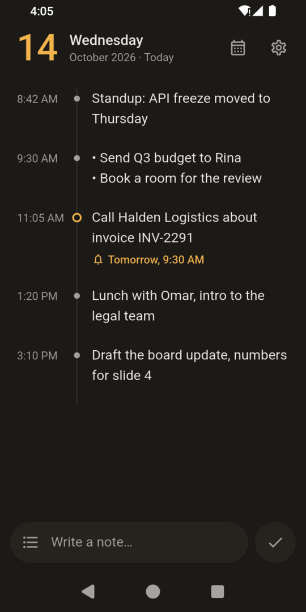
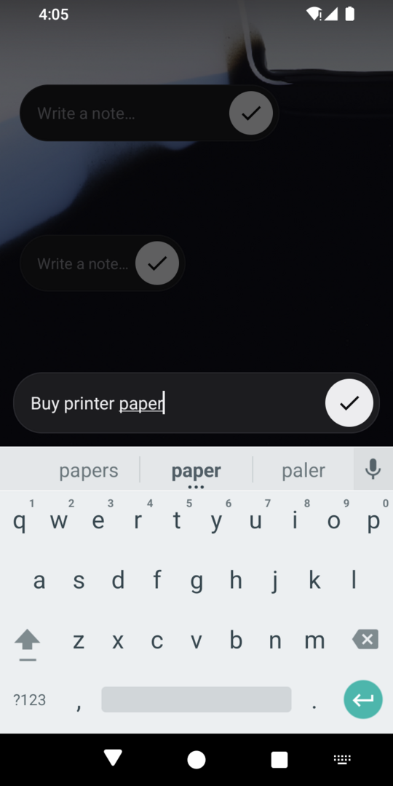
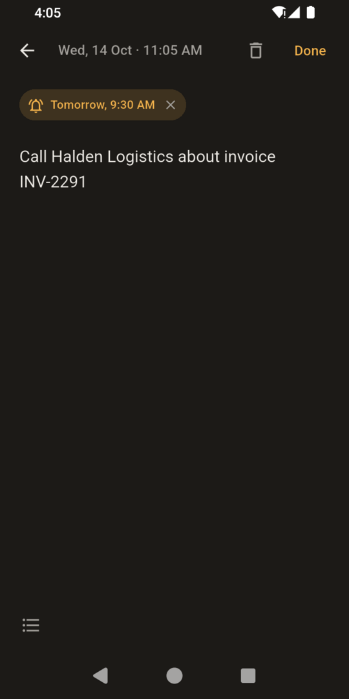
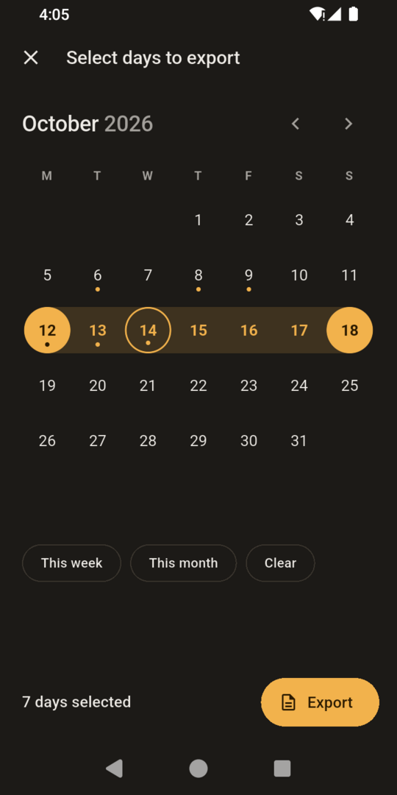
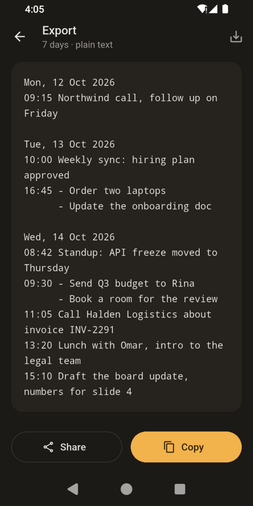
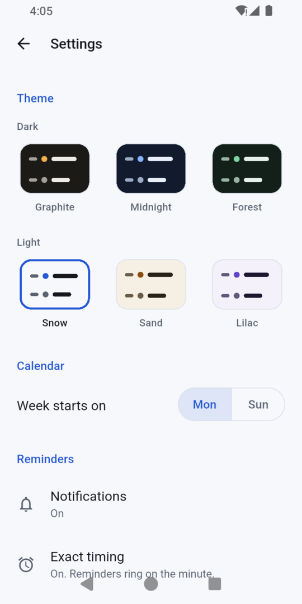

<p align="center">
  
</p>

<h1 align="center">jNote</h1>

<p align="center">
  Fast, offline daily notes for Android.<br>
  Write a note in two taps from your home screen.
</p>

<p align="center">
  <a href="https://github.com/JulfikarHDinar/jnote/releases/latest"></a>
  
  <a href="LICENSE"></a>
</p>

<p align="center">
  
  
  
</p>
<p align="center">
  
  
  
</p>

## Features

- **Two-tap notes** from a home-screen bar (3×1 or 2×1): type, tap ✓, done.
- **Daily timeline:** notes with their times and bullets. Tap to edit, swipe to delete, with Undo.
- **Calendar:** dots mark days with notes. Open any day to read or add notes.
- **Reminders that ring,** with Snooze 10 min and Dismiss. They survive restarts.
- **Export** any days as plain text: copy, share or save as a file.
- **Import** a saved file on another phone. Notes already there are skipped.
- **Six themes:** three dark, three light.
- **Private and light:** fully offline, no account, no ads, no tracking. Nothing runs in the background unless a reminder is set.

## Install

1. On your phone, open **[the latest release](https://github.com/JulfikarHDinar/jnote/releases/latest)** and download `jnote-<version>.apk`.
2. Open the file. If Android asks, allow your browser or Files app to install unknown apps.
3. Tap **Install**. jNote needs Android 8.0 or newer.

**Updating:** install the newer APK over the old one. Your notes stay.

## How it works

- **Notes belong to days.** jNote opens on today. The widget always writes to today; the calendar opens any other day.
- **Reminders** use Android's alarm service. jNote asks for notification permission only when you set your first reminder.
- **One text format** for export and import, so notes move between phones exactly:

  ```
  Mon, 12 Oct 2026
  08:42 Standup: API freeze moved to Thursday
  09:30 - Send Q3 budget to Rina
        - Book a room for the review
  ```

More detail is in the [user guide](docs/GUIDE.md).

## Permissions

| Permission | Why |
|---|---|
| Notifications | Shows your reminders. Asked when you set the first one. |
| Alarms & reminders | Rings on the exact minute. Without it, Android may ring a reminder up to an hour late. |
| Run at startup | Restores pending reminders after a restart. Off while no reminder is pending. |

jNote has no internet permission.

## Privacy

Your notes stay on your phone. They leave it only when you copy, share or save them yourself. Read the [privacy policy](PRIVACY_POLICY.md).

## Build from source

You need Flutter 3.47 or newer and the Android SDK (platform 36).

```bash
flutter pub get
flutter run      # on a connected phone or emulator
flutter test
```

- [Development notes](docs/DEVELOPMENT.md): structure, tests and performance.
- [Releasing](docs/RELEASING.md): signing, version numbers and publishing an APK.

## Changelog

See [CHANGELOG.md](CHANGELOG.md).

## License

[MIT](LICENSE) © 2026 JulfikarHDinar
